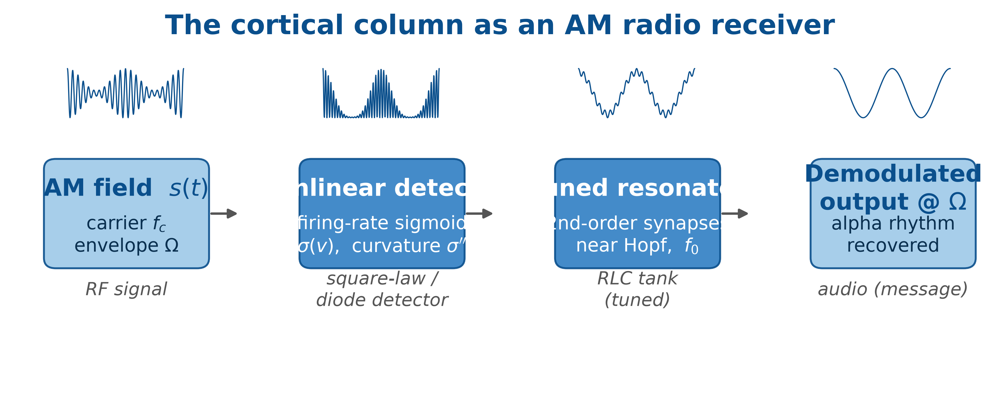
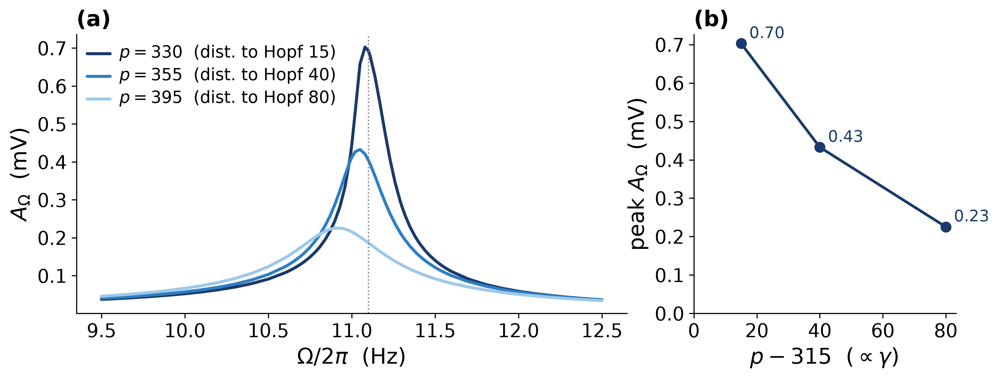

# TN0484 / WP0185 — The cortical column as a tuned receiver

[](https://doi.org/10.5281/zenodo.21009618)
[](https://creativecommons.org/licenses/by/4.0/)

**Paper:** *The cortical column as a tuned receiver: a network mechanism for
temporal-interference stimulation* — G. Ruffini, B. Mercadal, A. Just,
R. de Palma Aristides, F. Castaldo, N. Grossman, S. Canals, C. Mirasso.
Archived at Zenodo: **[doi:10.5281/zenodo.21009618](https://doi.org/10.5281/zenodo.21009618)**.
Licensed **CC-BY-4.0** (see [`LICENSE`](LICENSE)); machine-readable citation in
[`CITATION.cff`](CITATION.cff).

The current local draft is **v0.15.0-draft1** (October 4, 2026), in
[TN0484_envelope_demodulation.pdf](TN0484_envelope_demodulation.pdf) and
[TN0484_jne.pdf](TN0484_jne.pdf). As checked on October 2,
[Calliope WP0185](https://calliope.bcom.one/papers/WP0185) still lists v0.12.0
(July 21); the newer local draft remains pending Giulio's review and release.

v0.15.0-draft1 integrates Klaus's reconstructed LaNMM lock-in comparison and
corrects claim scope, gain units, and figure-reproduction paths. The old 7%/25%
claims are replaced by a defined beat average and two-window table. The kHz two-tone
illustration remains replot-only because its producer and complete settings are
unavailable. Section order and all 22 figures are retained. Record:
[docs/revision_2026-10-04_v0150draft1.md](docs/revision_2026-10-04_v0150draft1.md);
redline against v0.14.6:
[docs/redline_v0146_to_v0150draft1.pdf](docs/redline_v0146_to_v0150draft1.pdf).
Versioned review copies are under `build/`; release and circulation remain held.

v0.14.6 reviews v0.14.5 and applies four corrections: the shared-amplifier consequence is
restored in both abstracts, the gate-filter sentence states both halves of K's position,
the Cifra clause says what it is for, and the "not competing explanations" sentence returns
to the Discussion; $\chi^{(2)}$ enters Table 4. Record:
[docs/revision_2026-10-04_v0146.md](docs/revision_2026-10-04_v0146.md); redline against
v0.14.5: [docs/redline_v0145_to_v0146.pdf](docs/redline_v0145_to_v0146.pdf).

v0.14.5 frames weak-field mixing as an effective second-order response that combines
cellular contributions, with QIF as a derived realization. It explains the single-cell
content of the static curve, distinguishes small amplitude from fast relaxation, and
places direct carrier-evoked spiking outside the explanatory scope. It adds the qualified
Cifra citation and fixes the reversed efficiency-trend sentence. All 22 figures, their
order, and the simulation code and parameters are preserved. Record:
[docs/revision_2026-10-03_v0145.md](docs/revision_2026-10-03_v0145.md); redline against
v0.14.4: [docs/redline_v0144_to_v0145.pdf](docs/redline_v0144_to_v0145.pdf).

v0.14.3 (October 2) connects the fast-membrane NMM2 limit to a static population transfer
with dynamic synapses, distinguishes carrier access from cellular mixing and circuit
amplification, and adds Nir Grossman to the authors. Cohen's periaxonal study,
Luff's cellular-mixing work, and Raul's unpublished WP0242 manuscript remain cited.
The shorter effective access time is a modeling hypothesis; the plotted simulations
retain their original parameters. All 22 figures are preserved. The revision and
validation record is in [docs/revision_2026-10-02_v0143.md](docs/revision_2026-10-02_v0143.md),
with a [redline against v0.14.2](docs/redline_v0142_to_v0143.pdf).

**Abstract and storyline (October 3).** The inspection document K requested is
[planning/tn0484_abstract.tex](planning/tn0484_abstract.tex) (single-source abstract) and
[planning/tn0484_storyline.tex](planning/tn0484_storyline.tex) (section-by-section argument
map), compiled to [build/storyline/tn0484_storyline.pdf](build/storyline/tn0484_storyline.pdf)
with `~/.claude/skills/paper-storyline/scripts/build_storyline.sh planning/tn0484_storyline.tex`.
It maps v0.15.0-draft1, with the weak-field framing authorized by K and section order unchanged.
The three placement decisions remain open: Theory order, LaNMM methods, and figure
promotion. The
[general practice](../../giulio-personal-handbook/dos-and-donts.md#abstract-and-storyline-planning)
is maintained in the personal handbook.

Smooth weak-input cellular responses generically generate a quadratic beat when their
second-order coefficient is nonzero. The paper represents their combined contribution
through an effective population response and examines its recurrent amplification.
The Jansen–Rit sigmoid supplies a phenomenological realization; NMM2 supplies one derived
from QIF neurons. The spiking network tests that population description, and LaNMM
extends the mechanism to two resonant bands. Direct low-frequency stimulation shares
the amplifier when effective coupling, readout, and operating state are matched.

> **Key message:** *a nonlinearity mixes the two carriers into a difference-frequency
> component, and the recurrent network near its Hopf amplifies it selectively.* The
> static and dynamic descriptions are connected by their time scales. When membrane
> relaxation is fast relative to the input, the exact mean field reduces to a static
> rate curve; otherwise its mixing coefficient is dynamic. Generation and amplification
> remain separate contributions, with membrane access counted once.




## Repository layout

```
.
├── README.md                              # this file
├── LICENSE                                # CC-BY-4.0
├── CITATION.cff                           # machine-readable citation (DOI, authors)
├── TN0484_envelope_demodulation.tex       # the manuscript (\graphicspath{{figures/}})
├── TN0484_envelope_demodulation.pdf       # current build (48 pp; JNE article 31 pp + supplement 19 pp)
├── TN0484_envelope_demodulation.bbl       # committed so a single pdflatex works w/o bibtex
├── references.bib                         # BibTeX source for all references
├── requirements.txt                       # pinned Python deps (numpy/scipy/matplotlib + ...)
├── figures/                               # fig_*.pdf (used by LaTeX) + fig_*.png (preview)
├── code/                                  # all simulation/analysis code
│   ├── run_all.py                         # figure runner with dependency planning
│   ├── figstyle.py                        # shared house style (palette + apply() + panel())
│   ├── archive/                           # superseded/dead scripts (not in the live pipeline)
│   └── ...                                # generators + engines (see table below)
└── docs/
    ├── current_state.md                   # running changelog (newest on top — read first)
    ├── plan.md                            # planning / roadmap
    └── README_Code.md                     # code-level notes
```

## Setup

```bash
python3 -m venv .venv && source .venv/bin/activate
pip install -r requirements.txt          # numpy, scipy, matplotlib (+ deps)
```

## Build the paper

From the repo root (the `.tex` is at the root; `\graphicspath{{figures/}}`):

```bash
pdflatex TN0484_envelope_demodulation
bibtex   TN0484_envelope_demodulation
pdflatex TN0484_envelope_demodulation
pdflatex TN0484_envelope_demodulation
```

Current build: **48 pp (TN), 31 pp (JNE article) + 19 pp (supplement); 0 errors,
0 undefined references or citations, and no overfull boxes.** Bibliography month
macros and shared citation-label warnings are repaired. A float-only page notice
and an underfull bibliography line remain. The `.bbl` is committed, so a single `pdflatex` rebuilds the PDF
when references are unchanged.

## Reproduce the figures

The driver runs the available data producers before their figure generators.
Selecting a figure with `--only` includes its prerequisites. Scripts that draw a
group of figures still draw that whole group. Use `--dry-run` to inspect the plan
without running calculations or writing files:

```bash
cd code
python run_all.py --list
python run_all.py --only fig_resonance,fig_concept --dry-run
python run_all.py --only fig_resonance --figdir /tmp/tn0484-figures
python run_all.py --from-cache --only fig_jcurve,fig_khz_twotone --figdir /tmp/tn0484-figures
python run_all.py --figdir /tmp/tn0484-figures  # all available steps; heavy
```

`--figdir` (or `TN_FIGDIR`) redirects figure files. **It does not redirect data
caches:** simulations write into `code/`, including tracked `.npz` files. Run
recomputation in a separate checkout if those files must be preserved. The default
figure directory is `figures/`, whose files are overwritten unless redirected.

`--from-cache` only runs renderers with existing inputs; it never runs an inline
simulation or a data producer. Missing inputs and requests without a cache-only
renderer fail before execution. The uncommitted `analyses_v2.npz` and
`sweep_hi_stable.npz` must first be generated to replot their figures from cache.
The two-tone kHz figure is available only as a replot: its original producing run
and full integration parameters are absent. The LaNMM setup diagram is hand-drawn.
The dependency and failure checks run with `python code/test_run_all.py` from the
repository root.

### Figure → script table

22 figures are included by the manuscript. The table records the available scripts
and inputs; it does not assert a fresh rerun of every numerical calculation.
**Available** means the producer or renderer is present; **replot only** marks a
missing original data-producing run.

| figure | script | data dep. | scipy | status |
|---|---|---|---|---|
| fig_concept | `figures_v2.py` | analyses_v2.npz† | – | Available |
| fig_bifurcation_sigmoid | `figures_v2.py` | analyses_v2.npz†, jr_bifurcation.npz‡ | – | Available |
| fig_carrier_independence | `figures_v2.py` | analyses_v2.npz† | – | Available |
| fig_demodulation_twotone | `jr_twotone_figs.py` | (inline) | – | Available |
| fig_curvature_twotone | `jr_twotone_figs.py` | (inline) | – | Available |
| fig_resonance | `rerun_resonance.py` (stable/plot) | sweep_hi_stable.npz† | – | Available |
| fig_khz | `khz_analysis.py` | (inline) | yes | Available |
| fig_khz_direct | `khz_direct.py` (imports `timing_not_rate`) | (inline) | – | Available |
| fig_khz_twotone | `make_khz_twotone_fig.py` | khz_twotone.npz ‡ | – | **Replot only** |
| fig_jcurve | `make_jfig.py` | jcurve_main.npz, jcurve_res.npz ‡ | (engine) | Available |
| fig_nmm2_map | `nmm2_ping.py` | (inline grid) | – | Available |
| fig_nmm2_resonance_twotone | `make_nmm2_twotone_fig.py` | (inline grid) | – | Available |
| fig_nmm2_jcurve | `make_nmm2_jfig.py` | nmm2_jcD.npz ‡ | – | Available |
| fig_lanmm_field_p1_twotone | `make_lanmm_field_figs.py` | lanmm_field_P1_twotone.npz ‡ | – | Available |
| fig_lanmm_field_p2_twotone | `make_lanmm_field_figs.py` | lanmm_field_P2_twotone.npz ‡ | – | Available |
| fig_timing_not_rate | `make_timing_fig.py` | timing_not_rate.npz ‡ | – | Available |
| fig_mpr_crossover | `mpr_crossover_fig.py` | ping_fast_carrier_check.json ‡ (from `ping_fast_carrier_check.py`) | yes | Available |
| fig_qif_raster_twotone | `make_qif_figs.py` | qif_raster_twotone.npz ‡ | – | Available |
| fig_qif_timing_twotone | `make_qif_figs.py` | qif_raster_twotone.npz ‡ | – | Available |
| fig_tacs_jcurve | `tacs_jsweep.py` | tacs_jsweep.npz | – | Available |
| fig_entrainment | `make_entrain_fig.py` | entrain{,_b,_crit}.npz ‡ | – | Available |
| fig_lanmm_setup | — | — | – | **gap**: hand-drawn schematic |

Not included by the manuscript, kept in the repository only: `fig_lanmm_resonance` and
`fig_lanmm_map` (both `lanmm_resonance.py`), archived under `figures/archive/` with a note
on why; `fig_lanmm_arnold_p1`/`_p2` (`lanmm_arnold_tongues.py`), superseded by the
`fig_lanmm_field_*_twotone` maps; the `*_am` variants of the two-tone figures, retained so
the AM-surrogate control of Fig. 4d can be reproduced; and `fig_lanmm_checker.png`, a
diagnostic (gitignored).

† These caches are not committed. `run_all.py` includes their producers when
recomputing the corresponding figures, including when `--only` is used.
‡ Committed data: the corresponding renderer can reuse it without rerunning the sweep.

`khz_twotone.npz`, introduced in commit `a7d6e6f`, contains the input and output
spectra and `f1`, `f2`, and `F0`. It has no trajectory, time step, settling duration,
stimulus amplitude, or complete model-parameter record. The AM calculation in
`khz_direct.py` does not establish those missing two-tone settings. Its cached
spectra can be inspected and replotted, but exact recomputation is not currently
supported. `jr_bifurcation.npz` is imported AUTO continuation data; the raw branch
files and conversion script are in `code/jrnmm_plot/`, separate from the RK4 sweeps.
The legacy `fig_lanmm_arnold_p1/p2` additionally require the external `lanmmv11`
module; the current field-coupled LaNMM figures do not.

### Engines & helpers (not figure generators)

- `figstyle.py` — shared **house figure style**: the Neuroelectrics palette
  (`NEBLUE/NERED/NEGREEN/...`), an `apply()` that sets consistent type sizes / 300-dpi
  output / clean spines, and a `panel(ax,'a')` bold-label helper. Figure scripts opt in
  with `import figstyle; figstyle.apply()`.
- `jr_demod.py` — core JR engine (sigmoid + derivatives, vectorized RK4, AM field,
  lock-in, open-loop detector, Hopf helpers). Imported by the JR pipeline.
- `jr_jsweep_engine.py` — J-curve engine; imported by `run_jcurve/run_res/make_jfig`.
- `nmm2_jcA.py` — NMM2 J-curve engine (imported by `nmm2_jcD.py`).
- `timing_not_rate.py` — data producer for `fig_timing_not_rate` (writes the `.npz`;
  the figure is drawn by `make_timing_fig.py`). `qif_raster.py` integrates the
  **N=8000** QIF network and feeds `make_qif_figs.py`.
- `test_jr_demod.py` — self-checks (derivatives, fixed point, square law, control).

## Verified

`test_jr_demod.py`: sigmoid derivatives match finite differences (and σ″(v₀)=0);
the field-free fixed point is an equilibrium; square-law slope ≈ 1.99 (theory 2);
linearizing the field-receiving sigmoid collapses the response ≈712×. (Needs scipy.)

## Notes on artifacts

Currently committed: the rendered `.pdf` (re-committed each build), the `.bbl`
(so collaborators need not run bibtex), and the committed `.npz` data files so the
dependent figures rebuild without re-running the slow sweeps. LaTeX build junk
(`.aux/.log/.out/.toc/.blg`), `__pycache__`, `.venv/`, and a few regenerable
intermediate `.npz` are git-ignored.
